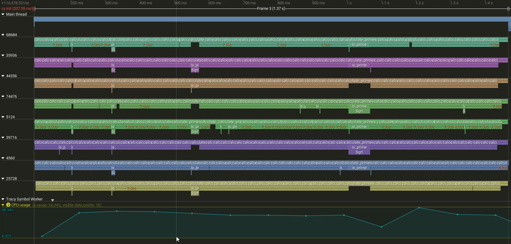

# Job System

Fibre based job system using windows fibres - based on the [Naughty Dog Talk about parallelizing their engine](https://youtu.be/HIVBhKj7gQU?si=k4v5Rrh6FPJRMSCY).

The api like the talk is very simple

```cpp
// where calculate primes is a static function, taking job_data_1/job_data_2 as a parameter
job_t jobs[] = {
    job::make<calculate_primes_job>(&job_data_1),
    job::make<calculate_primes_job>(&job_data_2)
};

job::counter_t* counter = nullptr;
job::run(context, jobs, &counter);
job::wait_for_counter(context, counter, 0); // this will block (yield this fibre) until all jobs are complete
```

Below is shows how the job queue can schedule jobs onto every thread reaching near 100% CPU usage (of P cores).


